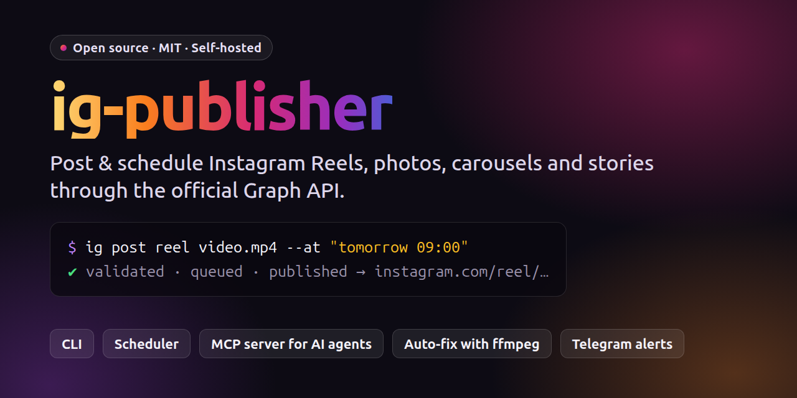

# ig-publisher



[](LICENSE) [](https://nodejs.org) [](#mcp-server) [](https://github.com/JavoxirJava/ig-publisher/releases)

**English** · [O‘zbekcha](README.uz.md)

A local, self-hosted tool that publishes Reels, photos, carousels and stories to an Instagram
professional (Business or Creator) account through the official **Instagram Graph API**,
either with Instagram Login (graph.instagram.com) or with Facebook Login and a linked Page.

You can use it in three ways:

- **CLI**: the `ig` command.
- **MCP server**: AI agents such as Claude Code or local LLM clients can publish, schedule and read stats.
- **Queue + systemd timer**: posts scheduled with `--at` are published automatically. The timer checks every 5 minutes.

There is no hosted backend. You use your own Meta app, and your token stays on your machine in `data/ig.sqlite`.

## Features

1. **Validation.** Uses ffprobe to check Instagram's media requirements: codec, fps, duration, size,
   aspect ratio and moov atom. It also checks caption limits: 2200 characters, 30 hashtags and 20 @mentions.
2. **Auto-fix.** Re-encodes with ffmpeg when needed (H.264/AAC, 23–60 fps, faststart) and converts PNG/WebP
   to JPEG. Use `--no-fix` to turn this off.
3. **Duplicate protection.** The same media is not published twice unless you pass `--force`.
4. **Upload.** Videos are sent directly with `upload_type=resumable` first. If that fails, the tool falls back to a public URL.
   Instagram accepts images and covers only by URL, so they are served through a **host**:
   - `tunnel`: a cloudflared quick tunnel. No setup needed.
   - `static`: your own web server.
   - `command`: any upload command, for example rclone or the AWS CLI for S3/R2.
5. **Wait and publish.** Waits until the container is `FINISHED`, then calls `media_publish` and returns the permalink.
6. **Resume.** If a run is interrupted, the next attempt finds the ready container and publishes it.
7. **Rate limits.** Checks the 24-hour publishing quota before posting. Queue failures are retried with backoff.
8. **Notifications and token refresh.** Sends optional Telegram notifications and refreshes the token automatically.

## Requirements

- Linux. The CLI and MCP server should also work on macOS, but that is untested. The scheduler uses
  systemd user timers, so it is Linux only.
- **Node.js ≥ 24**. TypeScript runs natively, so there is no build step.
- **ffmpeg / ffprobe** in `PATH`, or set `FFMPEG_PATH` / `FFPROBE_PATH` in `.env`.
- **cloudflared** for the default `tunnel` host. You can skip it if you use `static` or `command`.
- An Instagram **Business or Creator** account and a **Meta developer app**. See [SETUP.md](SETUP.md).

## Installation

```bash
git clone https://github.com/JavoxirJava/ig-publisher.git ~/ig-publisher
cd ~/ig-publisher
npm install
cp .env.example .env && chmod 600 .env
ln -s ~/ig-publisher/bin/ig ~/.local/bin/ig     # put `ig` on your PATH
npm test                                       # optional: full flow against a mock Graph API (needs ffmpeg)
```

Then connect your account:

```bash
ig auth token -        # paste the access token, press Enter, then Ctrl+D
ig doctor              # everything should be ✅ (Telegram is optional)
ig scheduler install   # optional: systemd timer for scheduled posts
```

**How to get a token** (about 30–60 minutes, one time):

1. Switch your Instagram account to **Professional** (Business or Creator).
2. Create an app at <https://developers.facebook.com/apps> with the use case
   *"Manage messaging & content on Instagram"*. Leave it in **Development** mode. App Review is
   **not** needed to post to your own account.
3. Go to **Instagram → API setup with Instagram login → Generate access tokens**, add your account,
   click **Generate token**, then run `ig auth token -`.

If your app only shows *"API setup with Facebook login"*, set `IG_LOGIN=facebook`. The full step-by-step
guide, including the OAuth flow, the Facebook Login flow and troubleshooting, is in [SETUP.md](SETUP.md)
(currently in Uzbek).

## Quick start

```bash
ig doctor
ig post reel video.mp4 --caption "Text #hashtag" --cover cover.png --dry-run   # validate only
ig post reel video.mp4 --caption "Text #hashtag" --cover cover.png             # publish
ig post reel video.mp4 --caption-file caption.txt --at "tomorrow 09:00"       # schedule
ig post carousel 1.jpg 2.png 3.mp4 --caption "..." --alt "description"
ig post story story.mp4
ig post --spec post.json
ig queue          # scheduled posts
ig history        # published posts, with permalinks
```

`--at` accepts `now`, `+30m`, `+2h`, `+1d`, `09:00`, `tomorrow 09:00` (or `ertaga 09:00`) and
`2026-10-27 18:30`. Times are in local time.

## Post spec (JSON)

```json
{
  "type": "reel",
  "media": ["/abs/or/relative/video.mp4"],
  "cover": "cover.png",
  "caption": "Text\n\n#tag1 #tag2",
  "shareToFeed": true,
  "collaborators": ["friend_account"],
  "label": "my-series-002"
}
```

- `type`: `reel` | `image` | `carousel` (2–20 media) | `story`.
- `media`: local files or ready-made `https://` URLs. Relative paths are resolved against the spec file.
- Optional fields: `captionFile`, `thumbOffsetMs`, `locationId`, `userTags` (`[{username,x,y}]`),
  `altText`, `audioName`, `aiGenerated`, `trial` (`MANUAL` | `SS_PERFORMANCE`), `fix` (default `true`).

A spec file is the easiest way to plug ig-publisher into your own pipeline, for example a video renderer.
Write `post.json` and run `ig post --spec post.json --at "..."`.

## All commands

```
ig auth token|url|login|status|refresh|logout
ig check <file> [--as reel|story|feed|carousel|cover]
ig queue [--all] | show|cancel <id> | retry <id> [--at ...] | run
ig limit | ig media | ig insights <media-id|account> | ig comments <id> | ig reply <id> <text>
ig scheduler install|uninstall|status   ig tick   ig notify-test
--json      machine-readable JSON on stdout (for agents and scripts)
```

Exit codes: `0` OK, `1` error, `2` bad usage, `3` duplicate.

## MCP server

Register it with Claude Code:

```bash
claude mcp add --scope user ig-publisher -- node --disable-warning=ExperimentalWarning ~/ig-publisher/src/mcp.ts
```

Any other MCP client can use the same stdio command: `node .../src/mcp.ts`.

Tools:

- `ig_account`, `ig_check_media`
- `ig_publish` (`dryRun`, `force`), `ig_schedule`
- `ig_queue_list`, `ig_queue_cancel`, `ig_queue_retry`, `ig_history`
- `ig_media_list`, `ig_insights`, `ig_comments`, `ig_reply`

A ready-made Claude Code skill is in [`skill/SKILL.md`](skill/SKILL.md). Copy it to
`~/.claude/skills/instagram-publisher/SKILL.md`.

## Multiple accounts

Each account gets its own env file and data directory:

```bash
mkdir -p profiles/second && cp .env.example profiles/second/.env
# in profiles/second/.env:
#   IG_PROFILE=second
#   IG_DATA_DIR=/home/you/ig-publisher/profiles/second/data
IG_ENV_FILE=$PWD/profiles/second/.env ig auth token -
IG_ENV_FILE=$PWD/profiles/second/.env ig scheduler install    # timer: ig-publisher-second
```

`profiles/` is git-ignored.

## Configuration

All settings live in `.env`. See [`.env.example`](.env.example) for the full list: login type, upload mode,
host, Telegram, API version, polling and retry options.

Telegram notifications are optional. Set `TELEGRAM_BOT_TOKEN` and `TELEGRAM_CHAT_ID`, then run `ig notify-test`.

## Project layout

```
src/config.ts      .env, paths, binary discovery
src/db.ts          node:sqlite (data/ig.sqlite): token, posts, queue
src/api/           http (errors/retry), auth (token, OAuth, refresh), publish, media (insights/comments)
src/media/probe.ts ffprobe checks + ffmpeg fixes
src/host/          tunnel (cloudflared + Range-capable file server), static, command
src/service.ts     publish orchestration
src/queue.ts       queue, time parsing, tick
src/scheduler.ts   systemd user timer
src/cli.ts, src/mcp.ts
test/              end-to-end tests against a mock Graph API (npm test)
```

## Security

- Never commit `.env`, `data/` or `profiles/`. They contain your access token and are git-ignored by default.
- The tunnel file server listens only on `127.0.0.1`. It serves only the files of the current post, under a
  random secret path, and shuts down after publishing.
- Tokens are redacted from logs and error messages.

## Disclaimer

This is an independent project. It is not affiliated with, endorsed by or sponsored by Meta or Instagram.
You are responsible for following the [Meta Platform Terms](https://developers.facebook.com/terms/) and
Instagram's rules for the content you publish.

## License

[MIT](LICENSE)
