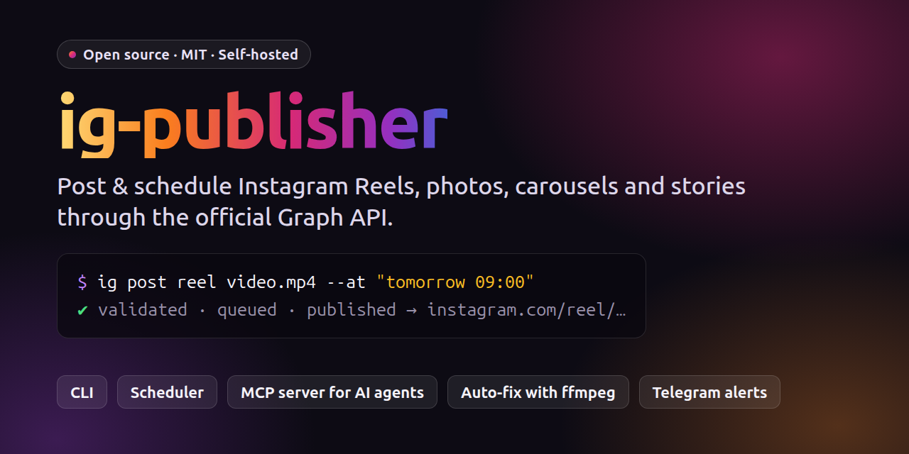

# ig-publisher



[](LICENSE) [](https://nodejs.org) [](#mcp-server) [](https://github.com/JavoxirJava/ig-publisher/releases)

[English](README.md) · **O‘zbekcha**

Instagram professional (Business yoki Creator) akkauntiga Reels, rasm, karusel va story joylovchi lokal
dastur. U rasmiy **Instagram Graph API** orqali ishlaydi: Instagram Login (graph.instagram.com) bilan yoki
Facebook Login va ulangan sahifa bilan.

Uni uch yo‘l bilan ishlatish mumkin:

- **CLI**: `ig` buyrug‘i.
- **MCP server**: Claude Code yoki lokal LLM klientlar kabi AI agentlar post joylashi, rejalashtirishi va statistikani o‘qishi mumkin.
- **Navbat + systemd timer**: `--at` bilan rejalashtirilgan postlar avtomatik joylanadi. Timer har 5 daqiqada tekshiradi.

Hech qanday tashqi server yo‘q. Siz o‘z Meta app'ingizni ishlatasiz, token esa faqat sizning kompyuteringizda
(`data/ig.sqlite`) saqlanadi.

## Imkoniyatlar

1. **Tekshiradi.** ffprobe bilan Instagram talablarini ko‘radi: kodek, fps, davomiylik, hajm, nisbat, moov atom.
   Caption limitlarini ham tekshiradi: 2200 belgi, 30 hashtag, 20 ta @mention.
2. **Tuzatadi.** Kerak bo‘lsa ffmpeg bilan: H.264/AAC, 23–60 fps, faststart. PNG/WebP rasmlarni JPEG'ga o‘tkazadi.
   `--no-fix` bilan buni o‘chirish mumkin.
3. **Dublikatdan himoya qiladi.** Bir xil media ikkinchi marta joylanmaydi; buning uchun `--force` kerak.
4. **Yuklaydi.** Video uchun avval `upload_type=resumable` sinaladi, ya'ni fayl to‘g‘ridan-to‘g‘ri yuboriladi.
   Ishlamasa, public URL usuli ishlatiladi. Rasm va cover uchun Instagram faqat URL qabul qiladi, shuning uchun
   ular **host** orqali beriladi:
   - `tunnel`: cloudflared quick tunnel, sozlash shart emas.
   - `static`: o‘z serveringiz.
   - `command`: istalgan yuklash buyrug‘i, masalan rclone yoki S3/R2 uchun AWS CLI.
5. **Kutadi va joylaydi.** Container `FINISHED` bo‘lguncha kutadi, so‘ng `media_publish` qiladi va permalink oladi.
6. **Davom ettiradi.** Jarayon uzilib qolsa, keyingi urinishda tayyor container topilib, to‘g‘ridan-to‘g‘ri joylanadi.
7. **Limitni tekshiradi.** Joylashdan oldin 24 soatlik limit ko‘riladi. Navbatdagi xatolar backoff bilan qayta uriniladi.
8. **Xabar beradi va tokenni yangilaydi.** Ixtiyoriy Telegram xabarlari yuboradi va tokenni avtomatik yangilaydi.

## Talablar

- Linux. CLI va MCP server macOS'da ham ishlashi kerak, lekin sinab ko‘rilmagan. Timer systemd user timer
  ishlatadi, shuning uchun faqat Linux'da ishlaydi.
- **Node.js ≥ 24**. TypeScript to‘g‘ridan-to‘g‘ri ishlaydi, build qadami yo‘q.
- **ffmpeg / ffprobe** `PATH`'da bo‘lishi kerak yoki `.env`'da `FFMPEG_PATH` / `FFPROBE_PATH` ni yozing.
- Standart `tunnel` host uchun **cloudflared**. `static` yoki `command` ishlatsangiz, u kerak emas.
- Instagram **Business yoki Creator** akkaunt va **Meta developer app**. [SETUP.md](SETUP.md) ga qarang.

## O‘rnatish

```bash
git clone https://github.com/JavoxirJava/ig-publisher.git ~/ig-publisher
cd ~/ig-publisher
npm install
cp .env.example .env && chmod 600 .env
ln -s ~/ig-publisher/bin/ig ~/.local/bin/ig     # `ig` ni PATH'ga qo‘shish
npm test                                       # ixtiyoriy: soxta Graph API bilan to‘liq oqim testi (ffmpeg kerak)
```

Keyin akkauntni ulang:

```bash
ig auth token -        # tokenni joylab, Enter, keyin Ctrl+D
ig doctor              # hamma narsa ✅ bo‘lishi kerak (Telegram ixtiyoriy)
ig scheduler install   # ixtiyoriy: rejalashtirilgan postlar uchun systemd timer
```

**Token qanday olinadi** (bir martalik, taxminan 30–60 daqiqa):

1. Instagram akkauntni **Professional** (Business yoki Creator) qiling.
2. <https://developers.facebook.com/apps> da *"Manage messaging & content on Instagram"* use case bilan app
   yarating. App **Development** rejimida qoladi. O‘z akkauntingizga post qilish uchun App Review **kerak emas**.
3. **Instagram → API setup with Instagram login → Generate access tokens** bo‘limida akkauntingizni qo‘shing,
   **Generate token** ni bosing va `ig auth token -` ni bajaring.

Agar app'ingizda faqat *"API setup with Facebook login"* chiqsa, `IG_LOGIN=facebook` ni yozing. OAuth usuli,
Facebook Login usuli va muammolar jadvali bilan to‘liq qo‘llanma: [SETUP.md](SETUP.md).

## Tez boshlash

```bash
ig doctor
ig post reel video.mp4 --caption "Matn #hashtag" --cover cover.png --dry-run   # faqat tekshirish
ig post reel video.mp4 --caption "Matn #hashtag" --cover cover.png             # joylash
ig post reel video.mp4 --caption-file caption.txt --at "ertaga 09:00"         # navbatga
ig post carousel 1.jpg 2.png 3.mp4 --caption "..." --alt "tavsif"
ig post story story.mp4
ig post --spec post.json
ig queue          # navbat
ig history        # tarix (permalink'lar bilan)
```

`--at` qabul qiladigan formatlar: `now`, `+30m`, `+2h`, `+1d`, `09:00`, `ertaga 09:00` (yoki `tomorrow 09:00`)
va `2026-10-27 18:30`. Vaqt lokal vaqt bo‘yicha olinadi.

## Post spec (JSON)

```json
{
  "type": "reel",
  "media": ["/abs/yoki/nisbiy/video.mp4"],
  "cover": "cover.png",
  "caption": "Matn\n\n#teg1 #teg2",
  "shareToFeed": true,
  "collaborators": ["dost_akkaunt"],
  "label": "my-series-002"
}
```

- `type`: `reel` | `image` | `carousel` (2–20 ta media) | `story`.
- `media`: lokal fayllar yoki tayyor `https://` URL'lar. Nisbiy yo‘llar spec fayliga nisbatan olinadi.
- Ixtiyoriy maydonlar: `captionFile`, `thumbOffsetMs`, `locationId`, `userTags` (`[{username,x,y}]`),
  `altText`, `audioName`, `aiGenerated`, `trial` (`MANUAL` | `SS_PERFORMANCE`), `fix` (standart `true`).

ig-publisher'ni o‘z pipeline'ingizga (masalan, video render qiluvchi skriptga) ulashning eng oson yo‘li spec fayl:
`post.json` yozing va `ig post --spec post.json --at "..."` ni ishga tushiring.

## Barcha buyruqlar

```
ig auth token|url|login|status|refresh|logout
ig check <fayl> [--as reel|story|feed|carousel|cover]
ig queue [--all] | show|cancel <id> | retry <id> [--at ...] | run
ig limit | ig media | ig insights <media-id|account> | ig comments <id> | ig reply <id> <matn>
ig scheduler install|uninstall|status   ig tick   ig notify-test
--json      natijani stdout'ga JSON ko‘rinishida chiqaradi (agentlar va skriptlar uchun)
```

Chiqish kodlari: `0` OK, `1` xato, `2` noto‘g‘ri buyruq, `3` dublikat.

## MCP server

Claude Code'da ro‘yxatdan o‘tkazish:

```bash
claude mcp add --scope user ig-publisher -- node --disable-warning=ExperimentalWarning ~/ig-publisher/src/mcp.ts
```

Boshqa MCP klientlar uchun ham shu stdio buyruq ishlatiladi: `node .../src/mcp.ts`.

Toollar:

- `ig_account`, `ig_check_media`
- `ig_publish` (`dryRun`, `force`), `ig_schedule`
- `ig_queue_list`, `ig_queue_cancel`, `ig_queue_retry`, `ig_history`
- `ig_media_list`, `ig_insights`, `ig_comments`, `ig_reply`

Claude Code uchun tayyor skill: [`skill/SKILL.md`](skill/SKILL.md). Uni
`~/.claude/skills/instagram-publisher/SKILL.md` ga nusxalang.

## Bir nechta akkaunt

Har bir akkauntning o‘z env fayli va data papkasi bo‘ladi:

```bash
mkdir -p profiles/second && cp .env.example profiles/second/.env
# profiles/second/.env ichida:
#   IG_PROFILE=second
#   IG_DATA_DIR=/home/siz/ig-publisher/profiles/second/data
IG_ENV_FILE=$PWD/profiles/second/.env ig auth token -
IG_ENV_FILE=$PWD/profiles/second/.env ig scheduler install    # timer: ig-publisher-second
```

`profiles/` git'ga qo‘shilmaydi.

## Sozlamalar

Barcha sozlamalar `.env` faylida. To‘liq ro‘yxat [`.env.example`](.env.example) da: login turi, yuklash usuli,
host, Telegram, API versiyasi, kutish va qayta urinish parametrlari.

Telegram xabarlari ixtiyoriy. `TELEGRAM_BOT_TOKEN` va `TELEGRAM_CHAT_ID` ni yozing, keyin `ig notify-test` ni bajaring.

## Tuzilishi

```
src/config.ts      .env, yo‘llar, binary'larni topish
src/db.ts          node:sqlite (data/ig.sqlite): token, posts, queue
src/api/           http (xato/retry), auth (token, OAuth, refresh), publish, media (insights/comments)
src/media/probe.ts ffprobe tekshiruv + ffmpeg tuzatish
src/host/          tunnel (cloudflared + Range'li fayl server), static, command
src/service.ts     publish orkestratsiyasi
src/queue.ts       navbat, vaqtni o‘qish, tick
src/scheduler.ts   systemd user timer
src/cli.ts, src/mcp.ts
test/              soxta Graph API bilan to‘liq oqim testlari (npm test)
```

## Xavfsizlik

- `.env`, `data/` va `profiles/` ni hech qachon commit qilmang. Ularda access token bor va ular standart
  holatda `.gitignore`'da.
- Tunnel fayl serveri faqat `127.0.0.1`'da tinglaydi. U faqat joriy postning fayllarini tasodifiy maxfiy yo‘l
  ostida beradi va joylashdan keyin yopiladi.
- Tokenlar loglar va xato xabarlarida yashiriladi.

## Eslatma

Bu mustaqil loyiha. U Meta yoki Instagram bilan bog‘liq emas va ular tomonidan qo‘llab-quvvatlanmaydi.
[Meta Platform Terms](https://developers.facebook.com/terms/) va joylagan kontentingiz uchun Instagram
qoidalariga rioya qilish sizning zimmangizda.

## Litsenziya

[MIT](LICENSE)
